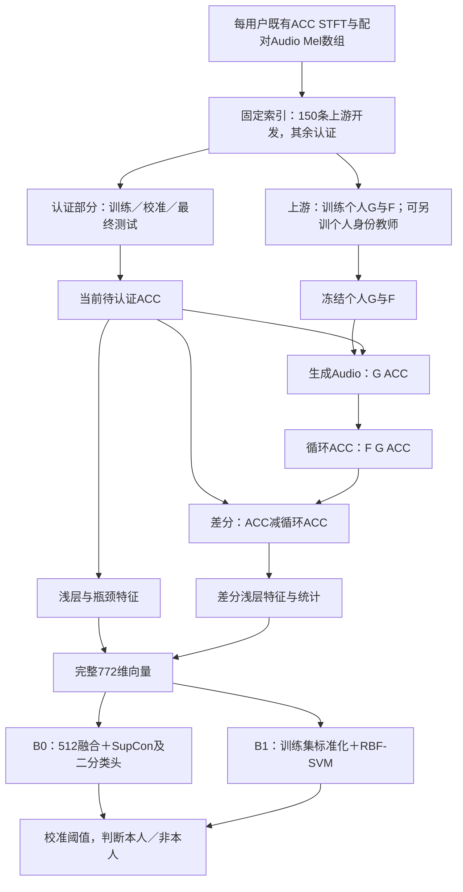

# 完整 baseline 与技术路线（固定记录，2026-10-28）

本文固定“完整 baseline”的含义和可复现入口。以后引用结果必须同时写明版本、目标用户、数据划分、特征、读出方式和阈值来源。

## 1. 版本定义

|编号|名称|认证输入与训练|用途|
|---|---|---|---|
|B0|旧 trainb 完整多源二分类 baseline|772维特征→512维融合→SupCon投影头及二分类头|保留用户原来的认证训练路线|
|B1|完整772维特征＋RBF-SVM|冻结G/F提取772维，标准化后训练目标用户二分类SVM|最近几轮对比学习实验表中的“完整 baseline”|
|T|教师补充候选|B0或B1加个人教师特征，必须注明具体分支、权重与训练划分|独立扩展，不并入无教师baseline|
|C|紧凑投影及双头候选|772维→64/128维，SupCon等训练后RBF读出|用于与B1对照；尚未稳定超越B1|

**B0与B1共享完整特征定义，但不是同一个认证算法。** 此前只用64维教师向量再接trainb结构的实验，也不是完整B0。不得将不同版本的指标混在同一行。

## 2. 总体技术路线

每个目标用户拥有个人G/F和个人认证器。同一个目标的生成器处理本人和全部攻击者输入；不按输入的真实身份选择生成器。认证推理只需要ACC，真实Audio只用于上游训练或离线诊断。

## 3. 数据与隔离

源数组为服务器 `/root/autodl-tmp/cycle1/meiy/{1..9}/{acc.npy,audio.npy}`，ACC为STFT、Audio为Mel。现有数组通常形状 `(N,80,81)`，读取为float32并截取 `[:, :80, :80]`，网络输入 `(B,1,80,80)`。

样本数：U1/U2/U5/U6=300，U3/U4=297，U7/U8/U9=299。代码中U1名称为`bo`，身份标签为0，其他用户标签依次为1–8。不能将路径名或标签编号直接当作已确认的真实姓名映射。

全部用户采用相同读取、裁剪、变换和特征算法。不能为提高某个用户指标，单独改变预处理或删除被误接受的测试样本。现有认证Dataset没有额外逐样本归一化；B1的StandardScaler作用于提取后的特征，且只在训练数据拟合。

旧数组的原始波形→STFT/Mel流程及其归一化统计来源，不能仅由数组或训练脚本注释完整还原。本次保存的是已核验源数组清单和代码接口；没有把未经核实的滤波频带、FFT参数、轴合成方法或归一化来源编造成既定事实。后续若重做原始信号处理，应独立命名版本并保留处理配置。

上游索引：对第`label`个用户，用`RandomState(42+label).permutation(N)`取前150条，排序保存；余下索引为认证集合。以完整索引清单和数组SHA256为准，不按“前150行”重新解释。

- 上游150条是模型开发池。U1训练脚本进一步以seed42分成120训练、15验证、15内部测试；因此“150条参与上游阶段”不等于150条全部用于梯度更新。
- 上游内部测试不等于认证测试。认证器只能使用上游150条之外的样本。
- 教师若作为补充，也必须使用相同上游索引；不能拿“前150行教师”拼接“随机150条生成器”，否则可能与认证部分重叠。

B1当前扩大认证测试协议：认证索引以`RandomState(42+1000+label)`重新排列，前60训练、接着30校准、其余最终测试。每个目标总训练540条，其中本人60、其他8人480；校准本人30、攻击240。U1/U4/U5最终本人60/57/60，攻击471/474/471。所有攻击身份保留。

B0旧协议使用认证池的60%训练、10%选模、20%开发、余下最终测试，攻击者开发/最终分配还受原协议逻辑影响。具体人数以对应run的manifest为准，**不能把B0旧结果和B1扩大测试协议当成只换算法的因果对照**。

## 4. 上游个人跨模态模型

当前U1/U4/U5复用200轮checkpoint：

`/autodl-fs/data/auth_full_pipeline_150x150_20260924/user{u}/cyclegan/model/checkpoint_epoch_200.pth`

认证阶段冻结G/F，`eval()`且无梯度，不在本轮补训。显式固定历史兼容定义 `/root/autodl-tmp/cycle1/experiments/samebo200safe_user3/model_drop.py`；不能直接导入可能已被新实验替换的同名模块。

该兼容定义的ACC→Audio为4个残差块的ResNet生成器，Audio→ACC为9块的U-Net ResNet生成器；基础通道64，含轴向注意力、InstanceNorm、Tanh输出。应以源码和严格加载checkpoint为准，不能笼统说两个方向结构完全相同。源码注释中的64×64不是本轮实际输入尺寸；本轮为80×80。

保存的U1训练脚本显示：实际循环`total_epochs=200`、batch16，Adam G/D学习率均1e-4，betas=(0.5,0.999)，梯度惩罚10；判别器前50轮每批5次、之后2次；生成器梯度裁剪1。学习率前50轮warmup，之后在本次200轮内保持平台。源码另有未用于循环的`num_epochs=500`，不可据此写训练了500轮。

损失包含双向WGAN对抗、真实配对L1重建、循环L1、identity mapping L1，以及判别器特征匹配、频率加权循环、ACC谐波梯度保持、Audio时间连续性项。**identity mapping是CycleGAN的同域映射约束，不等于用户身份监督。**

|epoch（0起）|adv|rec|cycle|identity mapping|freq|harmonic|temporal|feature matching|
|---|---:|---:|---:|---:|---:|---:|---:|---:|
|0–49|0.5|10|1|1|2|1|0.5|2|
|50–149|0.5→1|10→7|1→8|1→0.1|2|1→2|0.5→1|2→4|
|150–199|1|7|8|0.1|2|2|1|4|

中段依`p=(epoch-50)/100`线性插值，终点由第三阶段取到。上述训练细节来自保存的U1脚本；U4/U5本次只复用既有权重，没有重新声称已审计它们全部历史训练日志。

## 5. 完整772维特征的精确定义

设输入ACC为`x`，生成Audio为`m_hat=G(x)`，循环ACC为`x_hat=F(m_hat)`，有符号差分`d=x-x_hat`。

|分支|计算|维数|
|---|---|---:|
|输入浅层|G编码器前7个Sequential子模块，逐通道空间均值|128|
|输入瓶颈|G前14个子模块，逐通道空间均值及标准差拼接|256×2=512|
|循环差分浅层|将有符号d输入相同浅层编码器，逐通道空间均值|128|
|循环差分统计|d的全图均值、标准差、绝对值最大值、RMS|4|
|拼接|上述四块按顺序拼接|772|

标准差调用PyTorch默认`std`。不能把差分先全部取绝对值：均值和编码器分支保留的是有符号差分；只有max分量取绝对值。瓶颈切片是代码定义的截取点，不应凭名称认定它包括所有残差块或解码器。

这些是候选身份表征，不能仅凭它们来自循环就断言已包含稳定生物身份；需要认证与内容控制实验支持。

## 6. B0：旧trainb完整认证训练路线

冻结特征→`Linear(772,512)`→BN→ReLU→Dropout(0.1)→`Linear(512,512)`→BN。训练时再分两支：

- SupCon投影：512→256→BN→ReLU→128→L2归一化；以真实9用户身份标签定义同身份正样本和异身份负样本，温度0.07。
- 二分类：融合输出512维→Linear(512,1)；目标本人为1，其余用户为0。

`L = L_SupCon + beta * L_BCE`，默认beta=1，BCE正类权重为训练负类数/正类数。二分类使用未L2归一化的融合输出；模型的一般`return_embedding`接口会归一化，两者不能混用。

默认训练100轮、batch32、Adam lr1e-3、weight_decay1e-4，余弦调度至1e-6，梯度裁剪1。每类缓存至最大类样本数的2倍，首份原图，后续用统一SpectrogramAugment生成后再提取冻结特征；这些是增强视图，不是新的独立录制。

增强默认包括时间遮蔽、频率遮蔽、时间循环移位、噪声及幅度扰动，精确概率和范围保存在`data.py`快照。验证、校准及最终测试不增强。

每5轮验证，先按验证HTER低、再按AUC高选checkpoint；开发集提供验证时所用阈值，因此它参与了checkpoint决策，不能称完全独立事后校准。审计重跑包装器在选模时移除最终查询缓存，避免旧evaluate函数提前计算最终分数。最后只读取锁定checkpoint的最终结果。

## 7. B1：最近实验的完整特征baseline

直接使用772维，不使用训练后的旧512融合输出、128投影或旧二分类logit，也不加载旧认证头权重作为输入。

训练折内逐维`StandardScaler.fit`，变换后除以`sqrt(772)`；RBF SVC，`class_weight=balanced`。候选C={1,10,100}，gamma={scale,0.1}，用认证训练540条内按词分组的5折平均AUC选择；每折重新拟合标准化和模型。选定后在全部认证训练数据重拟合一次。

最终分数为SVM `decision_function`，不是已校准概率。数值越高越倾向本人。阈值在独立认证校准30正/240负上选取：先最小化`abs(FAR-FRR)`，再最小化HTER；查询分数≥阈值接受。禁止在最终测试上调阈值。

最近匹配实验B1的训练CV选择：

|目标|C|gamma|本人测试|攻击测试|TAR|FAR|AUC|
|---|---:|---|---:|---:|---:|---:|---:|
|U1|10.0|scale|60|471|91.67%|5.73%|0.9837|
|U4|1.0|scale|57|474|77.19%|18.78%|0.8454|
|U5|1.0|0.1|60|471|80.00%|24.63%|0.8456|

TAR=本人接受率，FRR=1−TAR，FAR=攻击接受率，HTER=(FAR+FRR)/2；AUC衡量排序，不对应某个固定阈值。总体FAR按所有攻击样本汇总，另保留逐攻击来源接受数，不能用不注明权重的“来源平均”替代。

## 8. 教师及紧凑头的路线边界

教师补充必须注明`E_A(x)`、`E_M(G(x))`或其他具体分支；认证时不能把真实Audio当作生成Audio替代。旧完整教师补充路线将两个64维向量与772维拼为900维，再重训融合层；后续RBF自动补充分支另有不同选择策略和权重，应引用各自报告，不写成同一baseline。

最近紧凑头实验在772维上学习64/128维向量，使用全批9身份SupCon＋目标BCE，再训练RBF。半难负类只在训练折挖掘、全部来源保留。匹配双头身份64、内容16，总参数62,415，与辅助关闭对照相同。U1/U4/U5三seed完成后均未稳定超越B1，不能将它们替换为默认路线。

身份保持的生成路线（冻结身份教师约束G）与认证时拼接教师向量是两种不同操作；仅做后者，不能宣称G接受了身份保持训练。本轮比较没有更新G。

## 9. 可复现文件与追溯

本地仓库根目录为 `C:/Users/windows/Documents/Codex/2026-09-24/github-plugin-github-openai-curated-remote`。以下路径均相对该目录：

- `work/baseline_snapshot_20261028/`：本次从服务器取回的`modelb.py`、历史兼容`model_drop.py`、`trainb_target_binary.py`、`trainb_target_150.py`、`data.py`，以及U1上游训练脚本、loader和loss/tools。
- 同目录`snapshot_manifest.json`：每份源码SHA256、字节数、版本区别、checkpoint路径与历史sha256记录。快照用于审计，不是脱离依赖可直接运行的一键工程。
- `work/run_complete_baseline_teacher_20261028.py`：固定历史模型导入、完整772维及教师扩展、最终分数延迟评估。
- `work/target_auth_protocol_150.py`、`work/run_expanded_auth_test_20261028.py`：旧协议和扩大测试协议。
- `work/personal_rbf_auth_20261028.py`：B1标准化与SVM读出。
- `work/run_contrastive_head_methods_20261028.py`、`work/run_contrastive_matched_active_20261028.py`：B1训练CV及最近对比实验入口。
- `outputs/complete_baseline_teacher_20261028_source_manifest.json`：九用户源ACC哈希、上游/认证索引。
- `outputs/contrastive_head_methods_20261028_U{1,4,5}_split_manifest.json`：本轮扩大测试逐样本角色清单。
- `outputs/contrastive_matched_active_20261028_results.json`：B1参数与本人/逐攻击者统计。

服务器B1相关缓存位于 `/autodl-fs/data/autoselect_diffusion_supplement_20261028/U{u}_features.npz`，本轮只使用键`{role}__base`；目录名字含diffusion不代表B1用了diffusion特征。对应训练输出在 `/autodl-fs/data/contrastive_matched_active_20261028`。

推荐复现顺序：核对源哈希和逐样本索引→严格加载固定G/F→重算并检查772维特征→按manifest重建认证角色→只在训练折选择配置→重拟合→校准阈值→最终一次评估并保存逐来源统计。旧脚本存在绝对路径与模块依赖，迁移机器先调整路径映射，不直接盲跑或覆盖历史输出。

## 10. 结论适用范围

当前属于已知负类身份参与训练的二分类闭集认证，不是未见攻击者开集结论。最终录制已被多次查看，结果属探索性。训练CV按词分组，不代表上游训练与最终测试已经完全按词隔离；缺行位置沿用用户“最后一组缺失”的说明，行号//10词标签仍有该假设。

不能将当前结果表述为已证明内容无关、跨会话泛化，或证明循环“增加了原ACC不存在的身份信息”。这些结论需要另设预先锁定配置的新词、新录制或未见用户确认实验。
