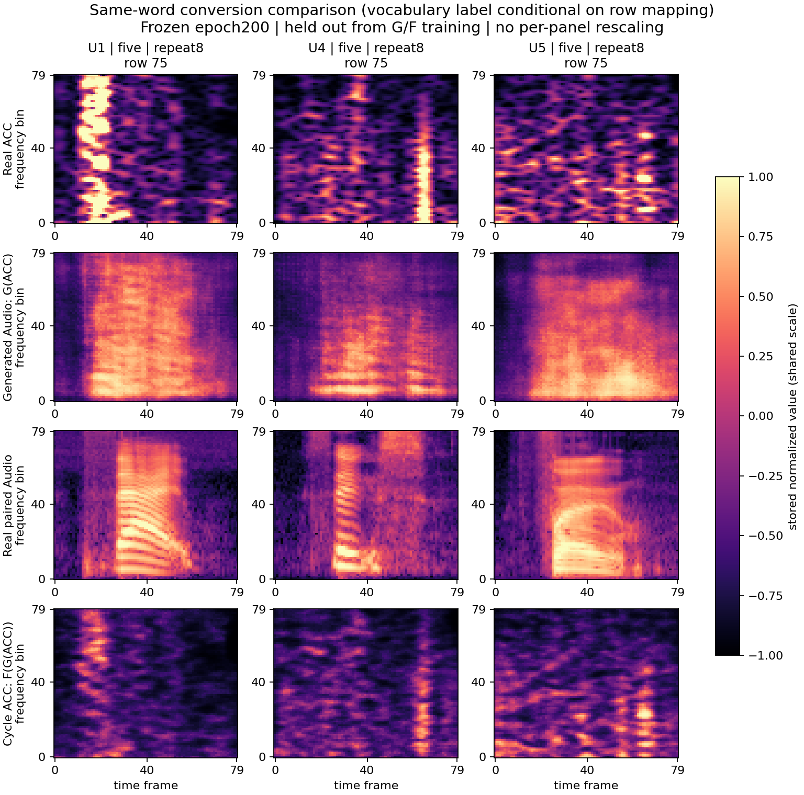

# 当前冻结个人模型的留出转化图

使用九用户认证实验对应的原始严格个人CycleGAN第200轮权重。本轮只做推理，没有训练生成器或改变预处理。

固定选取内容组5、第8次重复（0起重复7，数组行75），所有用户相同；U4/U5另固定内容组20/29的同次重复（行250/259）。全部行与各自生成器训练及验证录制互斥，属于当前同词认证最终测试，不按图像质量挑选。词义标签仍依赖已有10/20周期和相位映射，未逐录音独立转写。

四行依次为真实ACC、G(ACC)生成Audio、真实配对Audio、F(G(ACC))循环ACC。所有图像原值范围[-1,1]，共用同一色标，不逐图拉伸；横轴时间帧、纵轴频率bin，不将它们误标为秒或Hz。

可见生成Audio能形成部分低频能量与发声区间，但总体偏平滑，真实Audio的细密谐波未充分恢复。U4/U5三个词的补图中，生成结果有相似的低频形状；这提示细节与内容区分可能不足，但不能仅凭三例断言模式坍塌。循环ACC保留部分纹理，强度与细节仍有偏差。

该图不是身份嵌入或攻击者身份跟随测试：每个用户输入自己的ACC、经过自己的G/F。配对频谱相关性或循环相似性不等于身份保留，单个固定样本也不代表全测试集。最近新增Audio教师补充不会改变G/F输出，不能将认证融合改善解释为生成图变好。

代码：work/plot_current_conversion_20261030.py。数值诊断为outputs/mei_conversion_visuals_20261030/metrics_public.json；同时生成九人总览及U4/U5各三词图。公开图仅保存主对照，其他图可由同一脚本复现。

