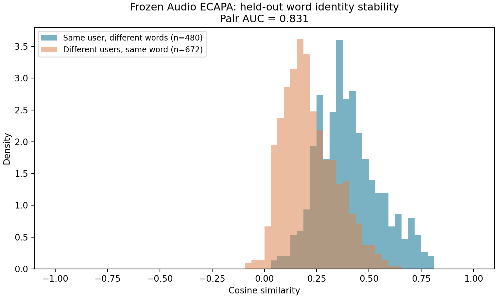
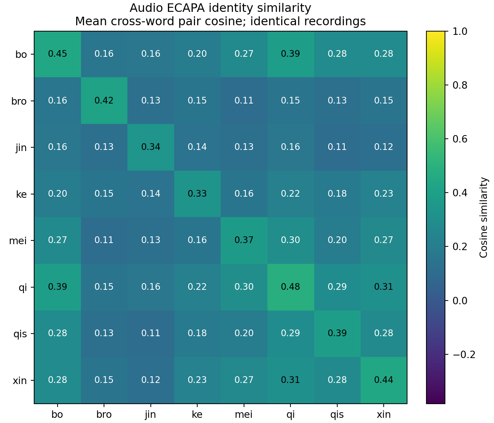
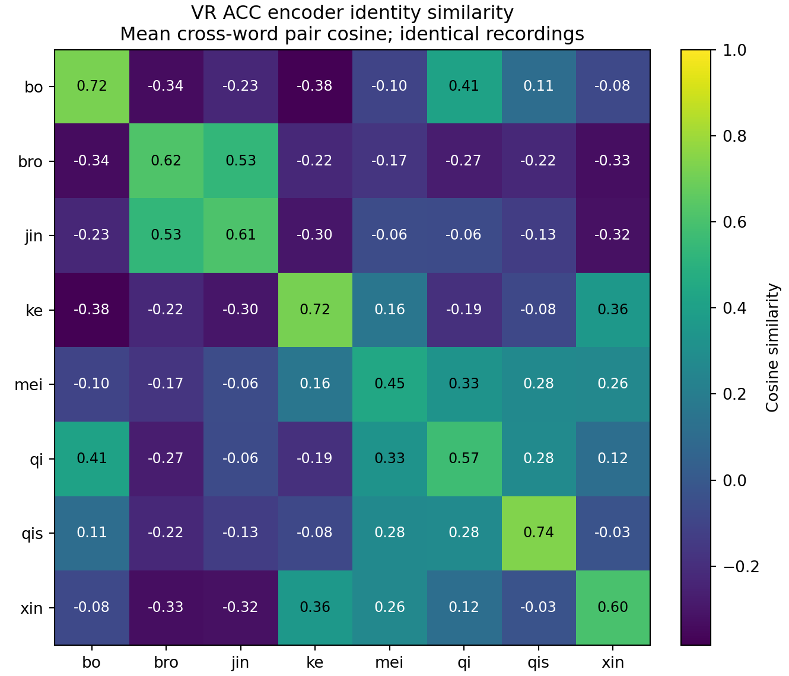

# 实验基线与教师诊断汇总（2026-11-08）

本页汇总九用户主体微调、排除 yue 后八用户基线、残差教师对照、同词认证及冻结教师关系诊断。保留全部声明用户群中的攻击来源，未按最终测试表现筛掉困难攻击者。

## 基线技术路线

统一预处理 → ResNet18 ACC 身份编码（192维、L2归一化）→ 可选小型身份残差适配/Audio关系蒸馏 → 认证训练折 StandardScaler → balanced RBF SVC → 校准折选择参数及阈值 → 最终留出录制评估。部署认证只使用 VR 输入。

VR 原始字段是 HMD 三轴速度，本文“ACC”为历史分支简称。输入使用10–300Hz速度频谱，不应将其描述成硬件原始加速度。Audio ECAPA 为 VoxCeleb 初始化后在 VibraVox 上训练的身份教师；八用户残差实验未使用含 yue 的本地九人微调教师。

九用户数据共2697组配对；排除 yue 后2397组。常规跨词划分：每人160条编码器训练、40条开发、20条认证头训练、20条校准、58–60条最终测试。原词标签依据录制顺序推断，未逐条完成语义核验。八用户编码器为重新训练的200步纯ACC模型；残差组在其上训练1000步，种子42、开发集选检查点。残差结构192→64→192，零初始化末层，修正范数不超过0.1。

这些本地实验的用户参与过编码器训练，因此属于已注册身份场景，不能作为未见身份开放集结论。同词和跨词对照样本数、词组成不同，不构成严格单变量比较。

## 汇总指标（宏平均，%）

|场景/方法|TAR|FAR|HTER|AUC|
|---|---:|---:|---:|---:|
|九人冻结ACC|74.94|9.45|17.26|87.67|
|九人ACC主体微调|75.68|9.68|17.00|88.09|
|九人Audio辅助主体微调|74.74|9.89|17.57|87.80|
|八人跨词冻结ACC|79.88|10.96|15.54|92.73|
|八人跨词身份残差|81.34|10.75|14.71|93.70|
|八人跨词残差+Audio|81.76|10.99|14.62|93.84|
|八人跨词可靠性Audio|80.92|10.75|14.92|93.74|
|八人跨词同平均强度Audio|81.34|10.90|14.78|93.86|
|八人同词冻结ACC|82.29|8.33|13.02|94.69|
|八人同词身份残差|84.38|8.04|11.83|94.73|
|八人同词残差+Audio|84.38|8.93|12.28|94.78|
|八人同词可靠性Audio|84.38|8.48|12.05|94.78|

目前有限残差适配有小幅改善，Audio辅助未证明稳定额外收益。单训练种子，未声称统计显著。

同词实验仅使用此前最终留出的 Down、Up、Zoom、Record、Play、Reset，所有人每词共同取8次录制，按相同随机排列分4/2/2次为认证训练/校准/测试。每人24/12/12条，七个攻击来源全部保留。这是六词池化认证头，并非逐词独立头。

## 冻结教师诊断图

八人六个留出词，每词两次，共96条；Audio及VR使用相同录制。同人异词平均Audio余弦0.403，异人同词0.217，配对AUC0.831。两模态28对异用户关系的Spearman相关0.496。配对共享录制，不是独立认证试验。

两张矩阵统一色标，均计算跨词录制对；对角线不使用自身比较。bro–jin在VR较接近而Audio较分离，值得后续检验选择性关系蒸馏；当前只是诊断假设。

## 详细记录

- [九人主体微调与yue核查](2026-11-08-mei9-acc-finetune-yue-audit.md)
- [八人残差及教师监督](2026-11-08-mei8-selective-teacher-residual.md)
- [八人同词认证](2026-11-08-mei8-sameword-teacher-residual.md)
- [冻结教师身份关系诊断](2026-11-08-mei8-teacher-identity-figures.md)
- [逐用户汇总JSON](results/2026-11-08/)

## 代码与复现边界

本次归档代码位于 [experiments/identity_kd](../../experiments/identity_kd)。八用户入口 run_mei8_exclude_yue.py，残差入口 run_selective_teacher_residual.py，同词入口 run_mei8_sameword_teacher_residual.py；教师图使用 extract_mei8_teacher_figures.py 和 plot_mei8_teacher_figures.py。依赖 numpy、torch、torchvision、scikit-learn、scipy、matplotlib，Audio提取还使用现有SpeechBrain模型环境。

保留实际执行版本及历史服务器路径以供追踪；这些是研究快照，并非下载即可完整重跑的独立发布包。脚本需要私有数据、已有编码器权重和对应模型运行环境；这些不公开。run_raw9_300.py、run_pilot.py、run_ecapa_pilot.py 一并归档作为共享依赖。部分早期文件名/顶层说明代表旧入口，以本页和具体协议为本轮实验范围依据。

本次仅发布代码、图及汇总指标，不发布原始录音、逐样本生物特征、模型权重或服务器认证信息。
