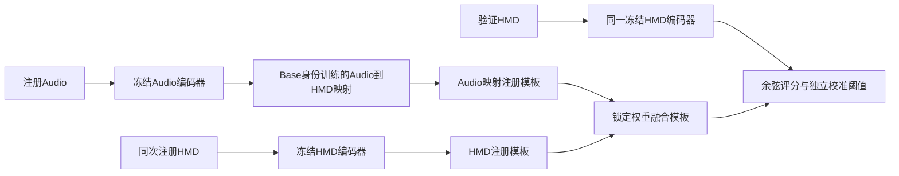

# 实验一P1：冻结编码器的双模态注册对照结果

对应最新方案P1 E0/E1/E2。E0仅HMD注册，E1仅注册Audio经映射建立HMD模板，E2融合两种模板；所有方法查询仅使用HMD。每人12次相同注册发声、完全相同的查询录制，每方法同词/跨词共享独立校准阈值。

此前蒸馏/残差不包含新用户注册Audio，不能替代本实验。本轮不训练大主干，只复用24个严格Base-only ACC检查点及两种冻结Audio编码器。

## 主要结论

- ECAPA的E2跨词HTER为22.48%，比E0的23.09%低0.61个百分点；TAR提高1.39个百分点，FAR提高0.17个百分点。三个种子HTER差值为-0.78、0、-1.04个百分点。八个目标中bo、qi、xin改善，其余五个持平。
- ECAPA 24折中15折选择lambda=0，仅9折采用少量Audio（0.1或0.25）；不能把全部结果称为Audio有效。其AUC仅85.612%→85.626%，排序区分度基本未变，改善可能主要体现为模板/分数工作点变化，不能据此声称增加了明显独立身份信息。
- ERes2NetV2的E2跨词HTER为23.87%，比E0高0.78个百分点，三个种子均变差。更换Audio教师并未保证注册融合有效。
- E1单用Audio映射模板明显差于E0：HTER约32%–33%。目前Audio→HMD身份空间迁移不足以替代HMD注册，仅ECAPA小权重融合出现弱正信号。
- 全部七攻击来源下，ECAPA E2的跨词HTER为23.70%（E0为24.22%），FAR从22.40%升至22.74%。尚未解决较高误接受率，不宜宣称实用认证成功，也不宜直接把这一结果上升为同步耦合创新。

## ecapa

|攻击口径|内容|方法|TAR|FAR|HTER|AUC|
|---|---|---|---:|---:|---:|---:|
|unseen_attacker|sameword|E0|75.00±4.63|21.53±3.05|23.26±3.84|85.21±0.96|
|unseen_attacker|sameword|E1|54.17±6.31|22.57±6.94|34.20±6.62|74.25±2.70|
|unseen_attacker|sameword|E2|75.52±4.63|21.70±3.35|23.09±3.99|85.25±0.99|
|unseen_attacker|crossword|E0|73.96±6.31|20.14±2.46|23.09±4.37|85.61±1.13|
|unseen_attacker|crossword|E1|55.38±4.49|21.70±3.77|33.16±4.09|75.18±2.93|
|unseen_attacker|crossword|E2|75.35±5.81|20.31±2.76|22.48±4.28|85.63±1.18|
|all_seven_sources|sameword|E0|75.00±4.63|23.09±0.04|24.05±2.30|85.14±0.33|
|all_seven_sources|sameword|E1|54.17±6.31|27.90±1.38|36.87±3.44|70.67±2.34|
|all_seven_sources|sameword|E2|75.52±4.63|23.26±0.23|23.87±2.27|85.18±0.44|
|all_seven_sources|crossword|E0|73.96±6.31|22.40±0.13|24.22±3.13|84.90±0.86|
|all_seven_sources|crossword|E1|55.38±4.49|28.10±1.69|36.36±1.46|71.30±2.84|
|all_seven_sources|crossword|E2|75.35±5.81|22.74±0.19|23.70±2.90|84.96±0.91|

lambda由Base内部开发选择，分布：{"0.1": 7, "0.25": 2, "0.0": 15}。lambda=0为合法回退，仍纳入统计。

|目标|E0跨词TAR|E0跨词FAR|E2跨词TAR|E2跨词FAR|E2-E0 HTER变化(pp)|
|---|---:|---:|---:|---:|---:|
|bo|93.06|0.00|95.83|0.00|-1.39|
|bro|88.89|76.39|88.89|76.39|0.00|
|jin|95.83|0.00|95.83|0.00|0.00|
|ke|95.83|44.44|95.83|44.44|0.00|
|mei|50.00|34.72|50.00|34.72|0.00|
|qi|13.89|1.39|19.44|2.78|-2.08|
|qis|83.33|4.17|83.33|4.17|0.00|
|xin|70.83|0.00|73.61|0.00|-1.39|

跨词严格未见攻击者E2-E0配对种子差值（百分点）：{"42": {"tar": 2.0833333333333335, "far": 0.5208333333333333, "hter": -0.78125, "auc": -0.043402777777777624}, "43": {"tar": 0.0, "far": 0.0, "hter": 0.0, "auc": 0.04340277777777901}, "44": {"tar": 2.083333333333333, "far": 0.0, "hter": -1.0416666666666665, "auc": 0.04340277777777485}}

## eres

|攻击口径|内容|方法|TAR|FAR|HTER|AUC|
|---|---|---|---:|---:|---:|---:|
|unseen_attacker|sameword|E0|75.00±4.63|21.53±3.05|23.26±3.84|85.21±0.96|
|unseen_attacker|sameword|E1|58.85±6.01|22.05±2.57|31.60±1.85|76.69±3.75|
|unseen_attacker|sameword|E2|75.17±3.35|21.88±3.17|23.35±3.26|85.19±1.02|
|unseen_attacker|crossword|E0|73.96±6.31|20.14±2.46|23.09±4.37|85.61±1.13|
|unseen_attacker|crossword|E1|54.51±5.85|19.44±4.55|32.47±1.67|76.27±4.25|
|unseen_attacker|crossword|E2|72.74±5.74|20.49±2.67|23.87±4.19|85.75±1.36|
|all_seven_sources|sameword|E0|75.00±4.63|23.09±0.04|24.05±2.30|85.14±0.33|
|all_seven_sources|sameword|E1|58.85±6.01|26.12±1.26|33.63±2.37|73.29±0.71|
|all_seven_sources|sameword|E2|75.17±3.35|23.21±0.07|24.02±1.70|85.08±0.45|
|all_seven_sources|crossword|E0|73.96±6.31|22.40±0.13|24.22±3.13|84.90±0.86|
|all_seven_sources|crossword|E1|54.51±5.85|25.74±2.11|35.62±1.88|71.22±0.46|
|all_seven_sources|crossword|E2|72.74±5.74|22.69±0.34|24.98±2.73|84.77±0.74|

lambda由Base内部开发选择，分布：{"0.1": 4, "0.25": 9, "0.0": 11}。lambda=0为合法回退，仍纳入统计。

|目标|E0跨词TAR|E0跨词FAR|E2跨词TAR|E2跨词FAR|E2-E0 HTER变化(pp)|
|---|---:|---:|---:|---:|---:|
|bo|93.06|0.00|75.00|0.00|9.03|
|bro|88.89|76.39|87.50|76.39|0.69|
|jin|95.83|0.00|95.83|0.00|0.00|
|ke|95.83|44.44|95.83|44.44|0.00|
|mei|50.00|34.72|50.00|34.72|0.00|
|qi|13.89|1.39|18.06|4.17|-0.69|
|qis|83.33|4.17|83.33|4.17|0.00|
|xin|70.83|0.00|76.39|0.00|-2.78|

跨词严格未见攻击者E2-E0配对种子差值（百分点）：{"42": {"tar": -0.5208333333333321, "far": 0.5208333333333333, "hter": 0.5208333333333321, "auc": -0.021701388888888118}, "43": {"tar": -2.083333333333333, "far": 0.5208333333333333, "hter": 1.3020833333333344, "auc": 0.0}, "44": {"tar": -1.0416666666666685, "far": 0.0, "hter": 0.5208333333333343, "auc": 0.43402777777777485}}

## 路线与解释边界

主干冻结 → Base训练轻量Audio→HMD映射 → Base内部开发锁定步数及融合lambda → 目标/Cal用同步注册对构建模板 → 各方法独立Cal阈值（同词/跨词共享）→ HMD-only最终查询。E0所有24折与旧原ACC结果完全复现，核对TAR/FAR/HTER/AUC及阈值最大差异0。

内层仅映射器留一Base身份，固定编码器曾见过这4名Base用户，不是完整内层未见身份重训。外层目标/攻击者未参与任何训练或开发选择。两条非精确配对fit样本仅从映射训练统一排除；注册池192条均有精确时间戳配对。词语编号仍未逐条语义核验，八人群体此前排除yue具有探索性局限。

均值及±标准差按先8目标宏平均、再3种子汇总；不是独立会话重复，不据小幅变化宣称显著收益。全部七来源含训练/校准已见身份，须与严格未见攻击者分开。E2融合有效也不能证明真实同步生理耦合，尚需C系列错配/错位控制。

验证评分函数只读取HMD查询和固定注册模板，不访问查询Audio、不运行Audio教师。每用户最终模板192维float32为768字节（不含协议和用户标识）；Audio及映射只用于注册。

[详细执行协议](2026-11-08-p1-enrollment-execution-protocol.md) · [原方案](2026-11-08-multimodal-enrollment-acc-only-verification-plan.md)
## 用户级不确定性

按每目标先平均三个种子的E2−E0差值，再对8个目标进行20000次配对用户重采样，seed20261108。仅作描述性区间：外层Base集合重叠、用户群体具有事后选择性，不能解释为严格独立样本置信保证。

- ecapa 跨词HTER配对差值均值 -0.61个百分点，描述性95%区间 [-1.22, -0.17]。
- eres 跨词HTER配对差值均值 0.78个百分点，描述性95%区间 [-1.04, 3.39]。

本轮ECAPA为VibraVox训练后冻结版，不包含尚未完成的本地按折Audio主体微调；这次只验证最新方案P1的既有冻结模型注册路径。

执行环境：复用服务器既有编码器缓存，轻量映射在本机CPU运行，两种Audio模型独立并行、每组Torch单线程。Python 3.10.3，Torch 2.5.0+cpu，NumPy 1.23.4，scikit-learn 1.4.2。不包含新主干训练。
